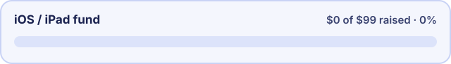

<p align="center">
  
</p>

<h1 align="center">Syllabi</h1>

<p align="center">
  The open-source study app for tablets: handwritten notebooks, an AI tutor, spaced-repetition questions
  and a calendar of everything due, all in one place.<br>
  <a href="https://syllabi.studio">syllabi.studio</a> ·
  <a href="#quick-start">Quick start</a> ·
  <a href="#self-hosting">Self-hosting</a> ·
  <a href="CONTRIBUTING.md">Contributing</a> ·
  <a href="https://github.com/AbdelrhmanX7/syllabi/discussions">Discussions</a> ·
  <a href="#support">Support</a>
</p>

<p align="center">
  <a href="LICENSE"></a>
  
  <a href="CONTRIBUTING.md"></a>
  <a href="https://buymeacoffee.com/AbdelrhmanX7"></a>
</p>

<p align="center">
  
</p>

## What it does

| | |
| --- | --- |
| **Classes** | Canvas classes in one place: grades, assignments, quizzes, files, pages, announcements. You can add classes that aren't on Canvas too. |
| **Today** | What's due, what's overdue and what to review next. |
| **Calendar** | Week and month views of due dates, exams, class times and reviews, each in its class colour. |
| **Notebooks** | A pen board with stylus pressure and palm rejection, pages per class or lecture, rulers and shapes. The AI can read your handwriting, explain a step and draw on the page. |
| **AI tutor** | Chat about any item, lecture or notebook page; it explains mistakes. |
| **Question bank** | Questions made from your material, with spaced repetition, mock exams and weak-topic tracking. |
| **Lectures** | Recordings or YouTube links become transcripts and lecture notes. |
| **Concept maps** | For any class or topic. Draw one or start from a photo; the AI builds a reference map or checks yours. |
| **Phone inbox** | Snap a worksheet or whiteboard on your phone and it lands on the tablet. |

Built for real student tablets such as the Samsung Galaxy Tab A7: it stays fast on 3–4 GB of RAM and works on older
Android WebViews.

## Quick start

You need Node 22+ and pnpm 10.

```bash
git clone https://github.com/AbdelrhmanX7/syllabi && cd syllabi
pnpm install
pnpm dev          # http://localhost:3016 (demo mode, no server needed)
```

With no server configured, the app runs entirely on built-in demo data, so every screen works offline. To use your
own data, point it at a Syllabi server with `NEXT_PUBLIC_API=https://your-server` (see `apps/study/.env.example`)
or in **Settings → Backend** on each device.

## Self-hosting

`apps/server` is the self-hostable backend: Express, MongoDB, Redis, any S3-compatible store and any
OpenAI-compatible model, packaged as a Docker Compose stack.

```bash
cd apps/server
cp .env.example .env   # set JWT_SECRET, MINIO_ROOT_PASSWORD, ADMIN_EMAIL/ADMIN_PASSWORD, model keys
docker compose up -d --build
```

The server is still catching up with the app, so a few features need a compatible `/study` API for now. See
[`apps/server/README.md`](apps/server/README.md) for TLS, the owner account and running without Docker.

## Android

`apps/study` is wrapped by Tauri 2 into an Android APK (bundle id `studio.syllabi.app`).
`node apps/study/scripts/android-release.mjs` builds a signed release. Set `STUDY_BUILD_API` to bake in a default
server, or leave it empty for demo mode.

## Repository layout

| Path | What's there |
| --- | --- |
| `apps/study` | The app: Next.js 16 (Pages Router, static export), React 19, Tailwind, React Query, Tauri 2 shell |
| `apps/server` | The self-hostable `/study` API |
| `apps/site` | The syllabi.studio landing page (`pnpm --filter @repo/site dev`, port 3018) |
| `packages/ui` | The clay design system every screen is built from |
| `packages/whiteboard-*` | The pen board engine and its React bindings |
| `tools/` | UI clip audit, perf tracing on simulated tablets |

## Contributing

Bug reports, ideas and pull requests are welcome.

- **Found a bug or want a feature?** [Open an issue](https://github.com/AbdelrhmanX7/syllabi/issues/new/choose).
- **Have a question or an idea to talk through?** Start a thread in [Discussions](https://github.com/AbdelrhmanX7/syllabi/discussions).
- **Want to write code?** Read [CONTRIBUTING.md](CONTRIBUTING.md) for setup, checks and the UI rules, then pick an
  issue labelled `good first issue` or `help wanted`.
- **Found a security problem?** Please report it privately; see [SECURITY.md](SECURITY.md).

Everyone taking part agrees to the [Code of Conduct](CODE_OF_CONDUCT.md).

## Support

Syllabi is free and built in spare time. If it helps you study, you can support it.

### Help bring Syllabi to iPad and iPhone

Publishing on the App Store needs an Apple Developer Program membership ($99 a year). Once the fund reaches it,
the iOS build goes to TestFlight and then the App Store.

<p>
  <a href="https://buymeacoffee.com/AbdelrhmanX7"></a>
</p>

Ways to help:

- [Buy me a coffee](https://buymeacoffee.com/AbdelrhmanX7)
- [Sponsor on GitHub](https://github.com/sponsors/AbdelrhmanX7)
- Star the repo, report bugs, or tell a classmate. That helps too.

## License

MIT. See [LICENSE](LICENSE). Bundled fonts are under the SIL OFL (`packages/ui/fonts/*-OFL.txt`).
