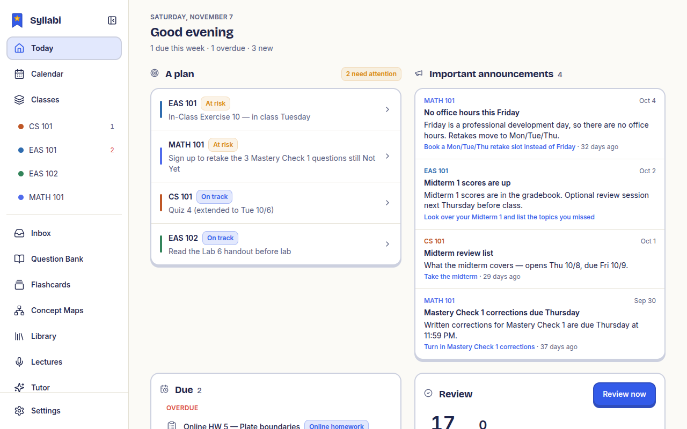

<p align="center">
  
</p>

<h1 align="center">Syllabi</h1>

<p align="center">
  A free study app for your tablet. Take notes by hand, see everything that's due, and get help when you're stuck.<br>
  <a href="https://syllabi.studio">syllabi.studio</a> ·
  <a href="https://app.syllabi.studio">Open the app</a> ·
  <a href="https://github.com/AbdelrhmanX7/syllabi/discussions">Talk to us</a>
</p>

<p align="center">
  <a href="LICENSE"></a>
  
  <a href="CONTRIBUTING.md"></a>
</p>

<p align="center">
  
</p>

## What it does

| | |
| --- | --- |
| **Classes** | All your classes in one place: grades, homework, quizzes, files and announcements. Works with Canvas, and you can add your own classes too. |
| **Today** | What's due, what's late and what to study next. |
| **Calendar** | Every due date, exam and class time by week or month, each in its class colour. |
| **Notebooks** | Write with your pen like on paper, with a page for every class or lecture. Ask for help on a step and it can explain it or draw on the page. |
| **Tutor** | Ask questions about any homework, lecture or page of notes. It explains where you went wrong. |
| **Practice questions** | Questions made from your own notes, brought back right before you'd forget them. Practice exams and a list of your weak spots. |
| **Flashcards** | Make cards from your notes and review them in a few minutes a day. |
| **Lectures** | Add a recording or a YouTube link and get the notes written out for you. |
| **Concept maps** | Draw how ideas connect, or start from a photo and get one made for you. |
| **Phone to tablet** | Take a photo of a worksheet or the board with your phone (iPhone or Android) and it shows up on your tablet. |
| **Use it with Claude or ChatGPT** | Connect your own AI assistant so it can see your classes and notes and help you study. |

Your notes follow you: sign in and they're on your tablet, phone and computer.

Tested on a Samsung Galaxy Tab S9 Ultra. It's made to run well on cheaper tablets too, but hasn't been tested on
them yet. If you try it on another device, tell us how it went.

## Try it

- **In your browser:** [app.syllabi.studio](https://app.syllabi.studio). Look around with sample data, or create a free account.
- **On an Android tablet:** download the app from [syllabi.studio/download](https://syllabi.studio/download).
  Every release is scanned on VirusTotal ([0 of 68 found anything in 0.1.0](https://www.virustotal.com/gui/file/db51185fe8fde5405c004aa1e359e4c94f28653a67a40cc60521d964be399e9b)),
  and its release page lists the file's fingerprint so you can check your download.
- **iPad and iPhone:** coming later.

<details>
<summary><b>For developers</b>: run it yourself, host your own server, release builds</summary>

### Run it on your computer

You need Node 22+ and pnpm 10.

```bash
git clone https://github.com/AbdelrhmanX7/syllabi
cd syllabi
pnpm install
pnpm dev
```

Then open http://localhost:3016. Without a server it uses sample data, so every screen works offline. To use your
own data, set `NEXT_PUBLIC_API=https://your-server` (see `apps/study/.env.example`) before you build. Running your
own server? Fork the repo, set it there, and build your own web app or APK.

### Host your own server

```bash
cd apps/server
cp .env.example .env
docker compose up -d --build
```

Fill in `.env` first (secrets, the owner account, AI keys). See [`apps/server/README.md`](apps/server/README.md) for
HTTPS and running without Docker. A few features still need a compatible server while it catches up with the app.

### Android builds

`node apps/study/scripts/android-release.mjs` builds a signed APK (app id `studio.syllabi.app`). Set
`STUDY_BUILD_API` to pick a default server, or leave it empty for sample data.

### Releasing

In GitHub, open **Actions → Release → Run workflow** and pick:

- `patch` for small fixes (0.1.0 → 0.1.1)
- `minor` for new features (0.1.0 → 0.2.0)
- `major` for big changes (0.1.0 → 1.0.0)

It bumps the version, builds the signed APK, attaches it to a GitHub Release and tells installed apps there's an
update. `notes` shows in the app's update banner. Tick `dry_run` to only build and check the APK.

### Where things are

| Folder | What's there |
| --- | --- |
| `apps/study` | The app (web and Android) |
| `apps/server` | The server you can host yourself |
| `apps/site` | The syllabi.studio website |
| `packages/ui` | The shared buttons, cards and other pieces every screen uses |
| `packages/whiteboard-*` | The pen and notebook engine |
| `tools/` | Checks for cut-off layouts and speed on slower tablets |

</details>

## Contributing

Found a bug, have an idea, or want to help build it? You're welcome here.

- **Found a bug or want a feature?** [Open an issue](https://github.com/AbdelrhmanX7/syllabi/issues/new/choose).
- **Have a question or an idea to talk through?** Start a thread in [Discussions](https://github.com/AbdelrhmanX7/syllabi/discussions).
- **Want to help build it?** Start with [CONTRIBUTING.md](CONTRIBUTING.md), then pick an issue labelled
  `good first issue` or `help wanted`.
- **Found a security problem?** Please report it privately; see [SECURITY.md](SECURITY.md).

Everyone taking part agrees to the [Code of Conduct](CODE_OF_CONDUCT.md).

## Support

Syllabi is free and made in my spare time. The best way to help: star the repo, report bugs, or tell a classmate.

## License

Free to use, copy and change (MIT, see [LICENSE](LICENSE)). Fonts are under their own free licence
(`packages/ui/fonts/*-OFL.txt`).
